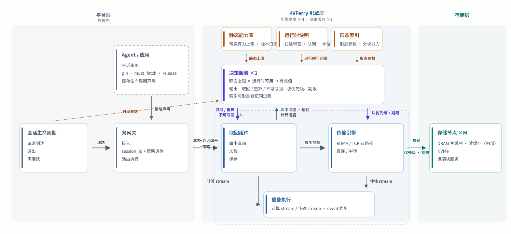
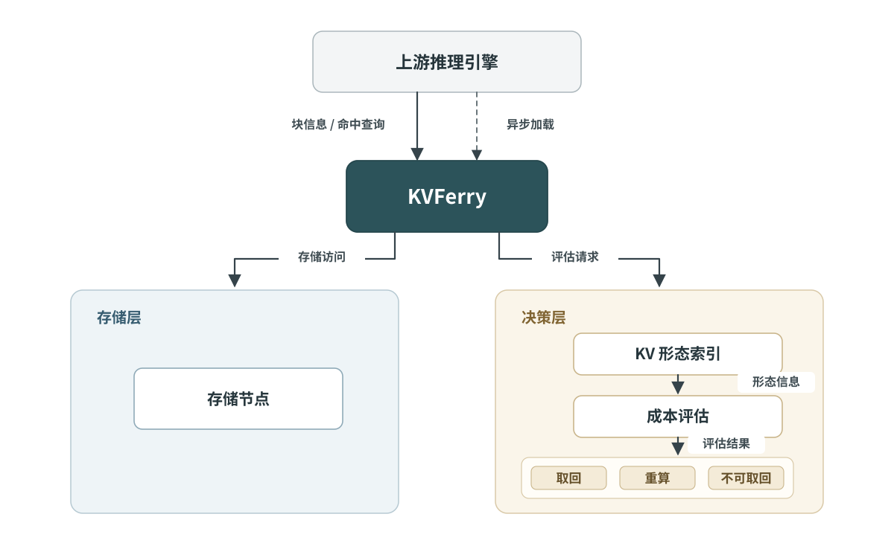

## KVFerry架构
#### 层级关系
引擎层作为主体，外加一层平台层作为外壳。
决策、传输、存储、重叠的执行逻辑都在引擎副本和决策服务里。
平台层只负责：网关透传 `session_id` 与策略字段并执行路由，存储节点按块读请求返回数据，k8s 清单负责拉起。

#### 部署形态
组件：一条薄网关、N 个引擎副本、一个决策服务、一个传输引擎和 M 个存储节点
控制面与数据面分离

- 网关负责接入、透传 `session_id` 与策略字段、执行路由，同一会话的请求共用一个 `session_id`，保留与升温靠它关联统计
- 每个引擎副本挂一个取回组件，副本之间不共享模型状态，一个副本故障不影响其余副本的 KV 池
- 决策服务把索引与形态登记放在同一进程，在请求路径上查表和算术，不做模型推理。
- 传输引擎嵌在副本与存储节点两侧
- 副本发起取回，存储节点按块读请求返回数据

## 架构总览

#### 三层组件分工
控制面是网关与决策服务：网关只做接入与路由执行，决策服务在请求路径上查表和算术，不做模型推理。
数据面是传输引擎与重叠执行。
离线的是标定工具，代价表由它跑出来，带版本下发。代价表缺失或过期时，决策退回重算，并记一条退回事件；退回期间，产品语义等于原生引擎加本地前缀缓存。

#### 三类参数输入决策层。
机器给能力参数：静态能力表记带宽与算力上限，运行时快照记此刻可用量，决策用合成后的有效值。代码只区分直连和中转两条路径，不判断硬件型号。
模型给形态参数：页式块、会话状态等形态进形态索引，决策按形态决定能做什么。
会话生命周期给时间参数：请求到达、逐出、再活跃三个时点各触发一次决策。

#### 静态能力表与运行时快照
决策输入分两层：静态能力表记这台机器的上限，运行时快照记此刻的可用量，两个合成为有效值后参与取回与重算的比较。

静态能力表由标定工具跑出，带版本与机器口径：

| 字段         | 内容                                                          | 数据来源                 |
|--------------|---------------------------------------------------------------|--------------------------|
| 路径带宽上限 | 本地拷贝、存储读取（按介质口径）、网络（RDMA 与 TCP 两口径）  | 标定工具的拷贝与存储两项 |
| 算力上限     | 按精度与方阵形状的重算吞吐                                    | 标定工具的重算一项       |
| GPU 秒折算   | 取回数据量对应省下的重算 GPU 秒，按模型口径折算，成本侧比较用 | 标定工具的算力一项       |
| 固定开销     | 取回建链、首块等待                                            | 标定工具                 |
| 干扰区间     | 拷贝与计算并发的系数区间                                      | 标定工具的干扰一项       |

运行时快照由决策服务维护，字段六项：在途取回带宽占用、取回队列深度与排队延迟、batch 空闲槽位、SM 利用率、显存可分配余量、KV 池水位。数据来源走现有接口：取回组件上报块读速率与队列深度，引擎钩子（prefill chunk 边界、step 进度）上报 batch 与 SM，显存与 KV 水位来自挂载接口的分配信息。快照读计数器，不在请求路径上做 benchmark，每 N 个请求或秒级刷新一次。

合成规则：

- 有效带宽 = 该路径上限 ×（1 − 在途占用比例）
- 有效算力 = 算力上限 × 空闲比例
- 取回时间 = KV 字节 ÷ 有效带宽 + 固定开销；重算时间 = 工作量 ÷ 有效算力
- 两个有效值都算完再比，输出带决策记录：查了哪张表、哪个时点、置信档是多少

带宽与算力各自独立判断：带宽空闲、算力紧张时走取回；带宽紧张、算力空闲时走重算。

#### 会话级缓存策略
应用可以在请求上声明缓存策略，网关把策略字段随 `session_id` 一起透传，决策层按会话给块打标记。

- `pin`：该会话的 KV 必须保留，逐出时跳过，落盘到持久层。
- `must_fetch`：命中后一律走取回，不走重算，接受更长的首 token 等待。
- `release`：应用声明会话结束，清除标记，块回到正常逐出流程。

标记带配额与过期时间。配额按会话的 KV 字节数算，超出后按最近最少使用回收；过期时间由应用指定，到期自动释放。同一会话存在并发子请求时，释放按引用计数扣减，计数归零才清标记。

应用侧不改业务代码：Agent 在请求体带 `session_id`，或配置 HTTP header `X-Session-ID`；策略放 `kv_transfer_params` 的 `kvferry_policy` 键，取值 `pin`、`must_fetch`、`release`。OpenAI 兼容客户端用 `extra_body` 携带这两项。框架有会话结束回调时，在回调里发一次 `release`。没有策略字段的会话，闲置超时释放由决策服务承担。

#### 三个时点
请求到达做确定性比较，输入是合成后的有效带宽与有效算力，加当前命中深度与层位。
逐出与再活跃做预测，输入里含对未来的判断。
预测带置信档，记录这次预测有多可信；置信不足时，决策退回保守动作，保留时沉远层不丢，升温时不动。
每条决策记录写清三项：查了哪张表、由哪个时点触发、置信档是多少。

#### KV块取回
取回沿用引擎现成的异步加载状态机，决策输出取回后，取回组件在命中查询里返回异步标记，调度器把请求置为远程 KV 等待状态。
传输引擎读块，读完上报完成。
调度器收到完成，才把请求排进 prefill。请求等待期间，其余请求照常计算，这段窗口就是主干重叠的时间。
取回失败或期限错过时，请求退出等待状态，整请求改重算。

## 使用流程
准备阶段：
1. 标定。标定工具在目标机器跑四张代价表，写下版本和机器口径，包括 GPU 型号、网卡、PCIe 拓扑、驱动、引擎版本。标定产物即静态能力表，入库后决策服务按版本加载。同一集群里，不同机型各用各的表。
2. 挂载。取回组件的配置指向决策服务和存储节点，网关与副本同机部署。副本配置 vLLM 的 KVConnector 指向决策服务，`kv_transfer_params` 只在挂载了 KVConnector 的副本上生效。挂载只改配置，不改引擎核心代码。摘掉配置，即回到原生引擎。

运行阶段：
3. 运行。`session_id` 与 `kvferry_policy` 随请求进入 KVConnector 回调，决策层按会话关联策略。命中查询返回命中深度与层位，决策层按合成后的有效值比较，输出取回、重算或不可取回。输出取回时，请求进入异步加载状态，传输引擎发起块读，块读与其余请求的计算重叠。加载完成后，调度器把请求放进 prefill，跳过命中段。输出不可取回时，请求直接重算，不发起取回。KV 从 HBM 逐出时，决策层决定它留在哪一层、留多久。同一会话再活跃时，决策层判断要不要提前把冷 KV 搬回近层或 HBM。升温与取回共用传输通路。
4. 降级。RDMA 不可用的机器把配置切到 TCP，传输指令和完成事件语义不变，代价表切到对应口径。代价表缺失、漂移或开销超标时，决策退回重算，产品语义等于原生引擎加本地前缀缓存。

上线后：
5. 运维。滚动升级、存储节点故障演练和配置热更新

## 上游引擎改动
根据上游接口现状，对上游的改动分三层：

零改动层不改引擎：
整请求级的预取与计算重叠走引擎现成的异步加载机制；更细粒度的层间流水走现成的按层等待回调。两者都不动核心，也不需要改变现有图捕获模式。

非核心钩子层只加开关：
把 prefill chunk 边界与 step 进度传给决策层，服务重叠执行与干扰标定，钩子开关关闭即回到原状。

核心最小补丁层解决非连续 KV 块取回：
上游引擎采用连续前缀命中语义，遇到首个缺失块后便不再统计后续命中块。分层存储场景下，不同 KV 块可能独立逐出，前面的块缺失时，后续块仍可能保存在远端。例如 Block 2 缺失，Block 3、4 仍可从远端取回；KVFerry 可以在重新计算 Block 2 的同时预取 Block 3、4，待前序依赖补齐后继续使用，避免重复计算。实现这一能力需要扩展调度器的块级状态记录、取回调度和输入构造逻辑，并通过原有调度测试集验证兼容性。

KV 形态由 KVFerry 自行管理：
上游接口只识别页式 KV 块，没有形态字段。KVFerry 在存储层与决策层之间建立形态索引，登记不同 KV 形态的参数及其分块取回能力，供决策层判断是否能够取回。未登记的形态默认不可取回，直接走重算路径。

| 层           | 改动位置                                     | 服务位置               | 回退方式       |
|--------------|----------------------------------------------|------------------------|----------------|
| 零改动       | 挂载接口三类回调、异步加载状态、按层等待回调 | 整请求级预取与层间流水 | 摘取回组件配置 |
| 非核心小钩子 | 把 prefill chunk 边界与 step 进度传给决策层  | 重叠执行与干扰标定     | 钩子开关关闭   |
| 核心最小补丁 | 非连续命中的记账、分配与输入构造             | 块粒度混合执行         | 补丁一键回退   |

#### 整体关系图

## 上游版本兼容策略
KVFerry 与上游引擎之间以接口语义作为长期契约，不绑定具体函数名、文件路径或版本号。双方通过块分配信息、命中查询、异步加载状态及按层等待回调等接口行为协作。

上游升级时，先对比接口行为、复核关键语义，如果发生变化评估受影响设计，必要时调整或降级

