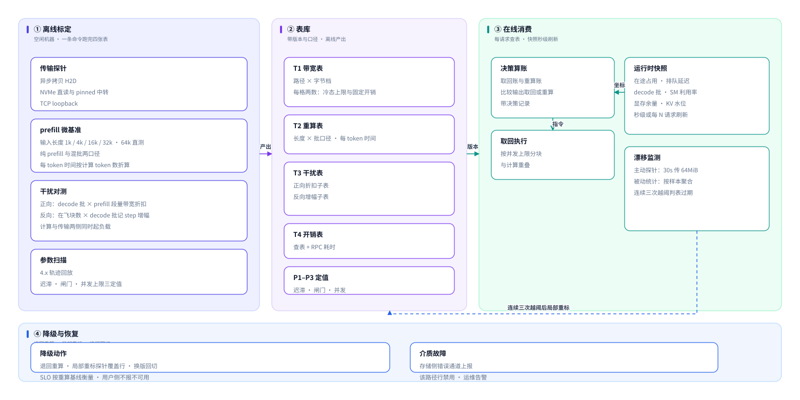

# 代价表

决策服务每处理一个命中请求都要算两笔账：把命中前缀从下层搬进显存要多久，重新计算这段前缀要多久。代价表提供这两笔账的单价与折扣，在空闲机器上标定产出，带版本入库，决策按请求查表。四张表分别是取回带宽、重算时间、双向干扰与决策自身开销，三个定值调决策行为，运行时快照提供此刻的负载坐标。

## 架构总览



标定由一条命令跑完，产物带版本与口径。决策服务按版本加载，查表时用快照的读数作坐标。探针与被动统计持续判断表是否过期，过期时只重标受影响的行，重标期间决策退回重算。

## 组成

| 编号 | 名称 | 回答的问题 | 更新时机 |
|---|---|---|---|
| T1 | 取回带宽表 | 这条路径搬 X 字节裸耗时多少 | 重标定时换版 |
| T2 | 重算时间表 | 这个模型算 N 个 token 裸耗时多少 | 换模型或精度时整表重标 |
| T3 | 干扰表 | 计算抢走几成带宽、传输拖慢几成计算 | 重标定时换版 |
| T4 | 决策开销表 | 一次决策自身的查表与 RPC 耗时 | 随版本 |
| P1–P3 | 迟滞、闸门、并发上限 | 决策翻转的抑制、拖累的容忍、在飞的约束 | 按机器各存一份 |
| S1–S6 | 运行时快照 | 此刻的负载与占用 | 秒级或每 N 请求 |

快照字段六项：在途取回带宽占用、取回队列深度与排队延迟、batch 空闲槽位、SM 利用率、显存可分配余量、KV 池水位。取回组件上报块读速率与队列深度，引擎钩子上报 batch 与 SM，显存与 KV 水位取挂载接口的分配信息，快照读计数器，不在请求路径上做测量。

表记冷态上限，即机器空闲时的物理能力。负载造成的差异由 T3 的折扣与快照的读数承担，表内不存热态数据。

## 标定

传输探针覆盖本地 DRAM、本地 NVMe 与 TCP 三类来源：DRAM 经异步拷贝进显存，NVMe 分直读与 pinned 中转两条路径，TCP 经 loopback。探针在独立进程里跑，与引擎进程分开，每格预热后测五次取中位数。

取回耗时对字节数做线性拟合。同一条路径按 8 MiB、64 MiB、256 MiB、1 GiB、4 GiB 五个字节档各测一遍，把耗时对字节数拟合出直线，斜率的倒数为稳态带宽，截距为固定开销。每格同时存中位数与 25% 分位数两份值，中位数留给重跑对账，25% 分位数供决策查询。最小档以直接实测为准，拟合只服务更大档位。NVMe 到 DRAM 的中转段按 8 MiB、64 MiB、256 MiB 三档另记。

线性关系用三重检查验证：相邻挡位算出的隐含带宽一致；拟合残差落在重复测量的噪声内；带宽接近链路物理上限，截距落在建链与首块的合理量级。哪一段残差超限，就在哪一段加密挡位。

重算微基准按固定输入长度批量打请求进引擎。输入长度取 1k、4k、16k、32k 四档，另对 64k 直测一次，覆盖长上下文尾部。每档分纯 prefill 与混批两种口径，混批按 chunk 段长配置同时持续发 decode 请求。每 token 时间等于 prefill 段耗时除以实际计算的 token 数，命中段不计入分母。档内按实际 token 数线性插值。每档同带宽表一样存中位数与 25% 分位数两份值。

干扰对测在同一格上同时起计算负载与传输负载，两侧分别记录。正向测计算挤传输：先空载测一条路径的带宽，随后挂上 decode 批与 prefill 段量，再测同一条路径，两值相除得折扣。反向测传输挤计算：先单独跑 decode 记每步时间基线，随后叠加在飞的块传输，再记同样的步时间，两者相减除以基线得增幅。

三个定值在同一套轨迹上扫描：迟滞系数扫 0.6 到 1.0 五档，取决策翻转少且首 token 时间不劣的一档；干扰闸门取 decode 步时间增幅 5%；并发上限取带宽接近饱和而步时间增幅仍在闸门内的拐点。

## 取回与重算

取回耗时按下式算：

```
取回耗时 = 排队延迟 + 固定开销 + 前缀字节 ÷ 有效带宽
有效带宽 = 该路径冷态上限 × 正向折扣 × (1 − 在途占用比例)
```

重算耗时按下式算：

```
重算耗时 = 未命中 token 数 × 每 token 时间 × 反向增幅
```

每项输入的来源固定：排队延迟与在途占用比例取快照，冷态上限与固定开销取 T1，正向折扣取 T3 正向子表，每 token 时间取 T2，反向增幅取 T3 反向子表。正向折扣的坐标是快照的 decode 批与 prefill 段量，反向增幅的坐标是本次决策拟发的在飞块数与快照的 decode 批。

两笔账都用 25% 分位数查表。坐标落在格点之间时按线性插值，插值前把坐标向不占便宜的方向取整：带宽取更低的一格，增幅取更高的一格。取回算慢的代价是首 token 时间拉长并占用带宽影响其余请求，重算算慢的代价只是多花算力，两种误差不对称，所以偏差统一压向重算一侧。

两笔耗时的差距落在迟滞带内时，本次不翻转动作，沿用上一次的决策结果。翻转门槛由 P1 调节，默认 0.8，避免两笔账接近时逐请求反复横跳。

## 决策开销

查表与算术的耗时、决策回调与取回组件的 RPC 耗时由标定离线实测，两项合计对照当前 decode 步时间的 1%。超过 1% 时本次不查表比较，直接输出重算并记一条开销超标事件；连续越线触发降级告警。排队延迟不进这一项，取快照的读数。

## 干扰表

正向子表记录计算负载下取回带宽的折扣，行是 decode 批（1、2、4、8、16、32），列是每步 prefill 的 token 段量，段量档取 512、1024、2048、4096 中部署实际启用的值，再加一列只有 decode 没有 prefill 的纯计算列。多个 prefill 请求同时切分时按每步总量查列，不按请求个数。

反向子表记录传输负载下 decode 步时间的增幅，行是在飞块数（1、2、4、8、16），列是 decode 批（1、2、4、8、16、32）。增幅供闸门判断：拟发的并发查出的增幅超过 P2 闸门，就下调在飞块数再查，直到落进闸门。

## 漂移与重标定

主动探针每 30 秒传一个 64 MiB 的固定块，实测耗时与表值偏差超过阈值且连续三个窗口成立，判定带宽表过期。被动统计覆盖重算一侧的漂移：决策服务记录每次 prefill 的段耗时与实际计算 token 数，每凑够 100 个在飞块数为零的有效样本聚合一次，用聚合值与 T2 的同档表值比对，连续三个窗口超阈值判定重算表过期。在飞块数为零时 prefill 不受传输拖累，聚合值才能与冷态表值直接比较。

阈值默认 20%，正式值取同机重跑偏差的 2 到 2.5 倍，标定完成后回填。探针只测传输路径，过期判定也只覆盖带宽表；重算表的过期由被动统计判定。

过期后只重标探针覆盖的行：主动探针触发时重标带宽表中对应的传输路径，被动统计触发时重标重算表中对应的长度档。其余表不动，整表重跑只用于换模型或换精度。

重标期间决策退回重算，产品语义等于原生引擎加本地前缀缓存。首 token 时间回到无缓存时的基线，加速功能暂时不生效。用户侧不报不可用，运维侧记表过期事件、降级窗口起止与重标结果。服务水平目标（SLO）按重算基线衡量，降级窗口天然落在达标范围内。介质故障由存储组件的错误通道上报，决策禁用对应路径行并退回重算，恢复与换盘走运维流程。

## 口径

带宽表的字节档为 8 MiB、64 MiB、256 MiB、1 GiB、4 GiB。重算表的长度档为 1k、4k、16k、32k，64k 单挡直测。挡位按查询分布选定：Kimi 线上 trace 的命中前缀 50 分位为 576 MiB、90 分位为 786 MiB，字节档覆盖这一段，4 GiB 挡覆盖长前缀尾部。挡位只用于拟合采样，查询按公式直接算，不按挡位取整。

块字节由形态索引换算：每 token 字节数乘以块内 token 数。FP16 换 FP8 折半，MLA 按压缩后的字节计。查询用前缀总字节，不用单块字节。

每张表带版本与口径。口径含 GPU 型号、网卡、PCIe 拓扑、驱动、引擎版本、模型、KV 精度与块大小。换模型或换 KV 精度时重标受影响的两张表，带宽表换字节换算口径，重算表整表重标。硬件特性只进表，代码只认直连与中转两条路径。

可调项及其默认值：

| 配置键                         | 默认值         | 作用                     |
|--------------------------------|----------------|--------------------------|
| `probe_interval_s`             | 30             | 主动探针间隔             |
| `probe_block_mib`              | 64             | 探针块大小               |
| `drift_threshold_pct`          | 20，标定后回填 | 带宽与重算的过期阈值     |
| `drift_trigger_consecutive`    | 3              | 连续越阈窗口数           |
| `drift_sample_min`             | 100            | 被动统计的最小有效样本数 |
| `drift_window_min_s` / `max_s` | 60 / 1800      | 聚合窗口的时间上下限     |

4060 版的带宽表网络行只有 loopback 口径，决策覆盖本机 DRAM 与 NVMe 两层，跨机路径不参与决策。本机 TCP 行为只作机制验证，收益结论以双机实测为准。

## 过关标准

- 四张表与三个定值齐全，每格有实测值与口径。
- 同机重跑一次，表值偏差落在阈值内并有记录。
- 三个定值各有扫描记录与选定值。
- 人为制造探针偏差，连续三个窗口越阈后触发局部重标，重标只覆盖该探针的路径行，其余表版本不变。
- 装置流量下被动统计产出的比对值落在阈值内，重算表判为有效。