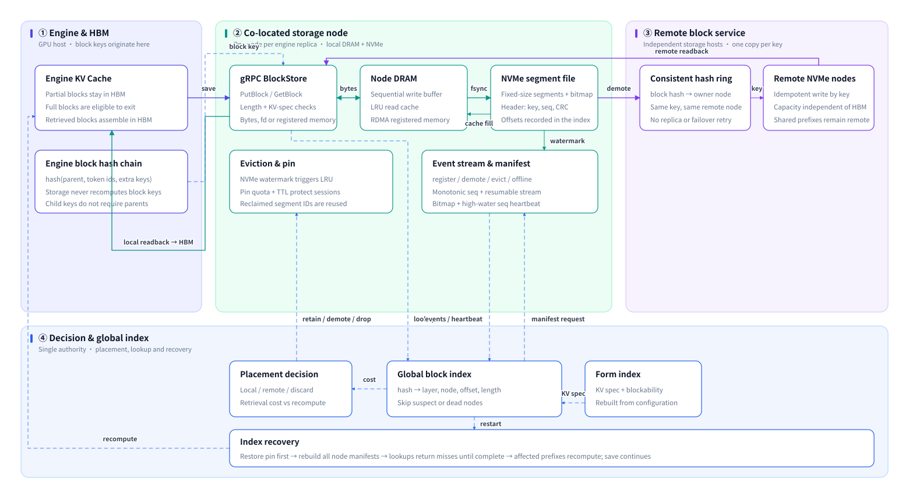

# 最小块存储

存储节点接收引擎逐出的 KV 块，写入本机 NVMe 与远端块服务两级；命中查询按块读回，交给取回组件装配进显存。索引与决策服务同进程，是全局唯一的权威账本，记录每个块的位置与层位。存储节点不解释块内容，读回与写入字节一致。

## 架构总览

图按数据面与控制面分开。实线表示块字节流动：引擎只逐出满块，存储节点写入本机 NVMe，或按保留决策下沉到远端；命中后块从本机或远端读回 HBM。虚线表示控制与元数据：决策服务用索引定位块、用形态索引核对口径，节点通过事件流与清单心跳维护索引。索引重建完成前，命中查询返回未命中，受影响前缀转重算，写入不受影响。

## 块格式与键

块对齐引擎 KV block，块字节大小运行时读引擎的 KVCacheSpec，含填充与对齐修正，不按公式自算。64 token、8 MiB 是 8B GQA FP16 口径的示例值，单机小模型按实际口径记录。

块键取引擎维护的满块哈希链，存储不自算键。引擎按键公式 hash(父块哈希, 块内 token ids, 附加键) 逐满块滚动计算，附加键含 LoRA 名称与路径、多模态内容哈希与块内偏移、缓存盐（仅掺链首块）、prompt embedding 区间摘要、投机解码 lookahead token。哈希链从 token 序列确定性重算，父块不在场也能算出子块键，Block 2 缺失时 Block 3、4 照常可查。键口径跟随引擎，引擎实现变化时跟随。

KV 口径（精度与每 token 字节数）随挂载声明，与代价表口径同一条链。读回先验长度，长度与声明不符的块丢弃、转重算并记事件。命中查询带本机口径，只在本口径内匹配，跨口径块视为不命中。

存储只登记满块。半块留在引擎内续填，满块后哈希链产出，才可入库。

## 存储节点服务

存储节点实现三个接口：块写入、块读回、清单上报，走 gRPC，单条消息上限 10 MB。块读回的返回形态预留零拷贝余量：可返回注册过的连续内存或 fd 加偏移，供传输引擎直通显存。

NVMe 用一个数据大文件加偏移，每块占一段，偏移记进索引。段定长，单节点只服务一种块口径，空闲段用位图管理，驱逐产生的空洞直接重用。段头自描述：魔数、键、序列号、CRC。

DRAM 承担三件节点内事务：save 的写缓冲、读缓存、RDMA 注册内存。读缓存按 LRU 留住热块，容量写配置，配置为零时全部读请求走 NVMe。读缓存对索引与决策不感知，决策按 NVMe 口径算取回成本，缓存命中只会更快。

save 把满块交给保留决策，决策给出落本机、落远端或丢弃。save 的写入速率上限按静态能力表写方向表值的比例配置。

## 远端块服务

远端块服务是一组跑在独立存储机上的节点，与 GPU 机器分离。块按键分布到一致性哈希环上：同键块收敛到同一个节点，同键写入即幂等覆盖，全集群一份。本机淘汰时，保留决策指定下沉的块推送到远端，直接丢弃的块不进远端。远端容量与本机解耦，pin 会话与公共前缀的块集中存放在远端，跨机请求也能命中。

## 索引与清单

索引与决策服务同进程，存两样：块哈希到（层、节点、偏移、长度）的映射，形态索引（KV 形态、每 token 字节数、能否分块取回、搬迁单位、KV 口径）。形态索引随引擎配置下发，重启从配置重建，不进软状态。

索引是软状态，靠实时事件与周期心跳维护。写入登记、下沉、驱逐、失联、超限拒收五类事件经 gRPC 事件流实时推送，索引即时更新。心跳默认 30 秒一次，周期写配置，带节点编号、块哈希列表、各块层位与偏移、容量水位，做兜底对账；单节点清单超过阈值时分片上报。

节点端保存段清单：段占用位图加高水位序列号的快照为主路径，段头自描述为兜底。索引进程重启后从各节点的段清单逐条重建；重建完成前命中查询一律按未命中返回，请求走重算，save 不受影响。错误命中比重算更贵。pin 列表单独持久化，重启先恢复 pin，再重建普通登记。

## 放置与驱逐

块单向流动：HBM 逐出经 save 落盘或落远端，读回直送 HBM。读请求不抬层，升温是唯一把块搬向近层的动作，由决策在会话再活跃时发起。

NVMe 水位超过阈值按 LRU 驱逐。驱逐先逐未标记块，pin 块按配额与过期时间管理，超配额按 LRU 回收，到期自动释放。驱逐与下沉实时发事件，带块哈希与原因。

同键规则：同节点同键覆写同段；跨节点同键多份合法，会话粘性漂移后新旧节点各存一份，索引按节点分片各记各的，命中就近取用，各节点驱逐各自注销。

## 节点故障语义

失联判定按连接状态：节点与决策服务的连接断开即进疑似，摘出调度池，数据保留；疑似持续 30 秒未重连判死，路由绕行，受影响前缀走重算；阈值进配置。复活重连后滞回一个周期再回正常。

命中查询跳过失联节点的块，命中深度截断在失联边界：边界前的块照常取回，边界后的段落重算。跳过失联块继续取回后续块依赖引擎的非连续装配，作为演进项。

节点恢复：重连、重新上报清单、重新登记。盘损坏走运维换盘，介质故障由错误通道上报，决策禁用对应路径行并退回重算。

## 对账与维护

对账分两层。元数据全量对账每轮跑：盘上有段而索引无登记的孤儿段，读段头验证键与 CRC，完好补登记，损坏释放；索引有登记而盘上无的段，注销登记。数据抽读为第二层：每轮随机抽 1% 的已登记块读回重算哈希，与登记对照，不足一百块抽一百块，分批限速。

三种不一致的处置：哈希不符注销该块并记事件；残留段未释放即释放；孤儿段修复优先、回收兜底。

## 部署形态

存储节点与引擎副本同机，一机一个节点，用本机 DRAM 与 NVMe。单机场景进程级脚本拉起，集群场景由 k8s 清单按 DaemonSet 拉起并负责滚动升级。远端块服务跑在独立存储机上。

节点之间没有通信、没有数据搬迁，唯一的全局协调是发往决策服务的事件与心跳。传输分直连与中转两条路径：直连为本机 GPUDirect Storage 与 pinned 拷贝，NVMe 直达显存；中转为跨机 RDMA 与 GPUDirect RDMA，服务跨机取回与远端读写。

## 口径

块字节由形态索引换算：每 token 字节数乘以块内 token 数，与代价表共用同一条换算链。

可调项及默认值：

| 配置键                 | 默认值 | 作用                         |
|------------------------|--------|------------------------------|
| `heartbeat_interval_s` | 30     | 清单心跳间隔                 |
| `down_after_s`         | 30     | 断连判死时长                 |
| `read_cache_bytes`     | 64 GiB | 读缓存容量，0 为关闭         |
| `nvme_watermark_pct`   | 90     | NVMe 驱逐水位                |
| `audit_sample_pct`     | 1      | 抽读比例，不足一百块抽一百块 |
| `rpc_max_message_mb`   | 10     | gRPC 单条消息上限            |

命中率分层统计：本机命中（盘读与读缓存两个时间口径）、远端命中、失联跳过、未命中。指标族落指标文档的存储节。

## 过关标准

- 随机抽块读回校验哈希，索引与数据对账一致。
- 杀一个存储节点，服务继续，分层命中率下降幅度有数，预期等于该节点承担的块占比。
- 索引进程重启，重建窗口内请求全走重算，无错误命中。
- 节点恢复后命中率回到故障前水平的时间有数。
- 同键块在远端块服务全局单份，本机淘汰下沉远端后键仍可命中。